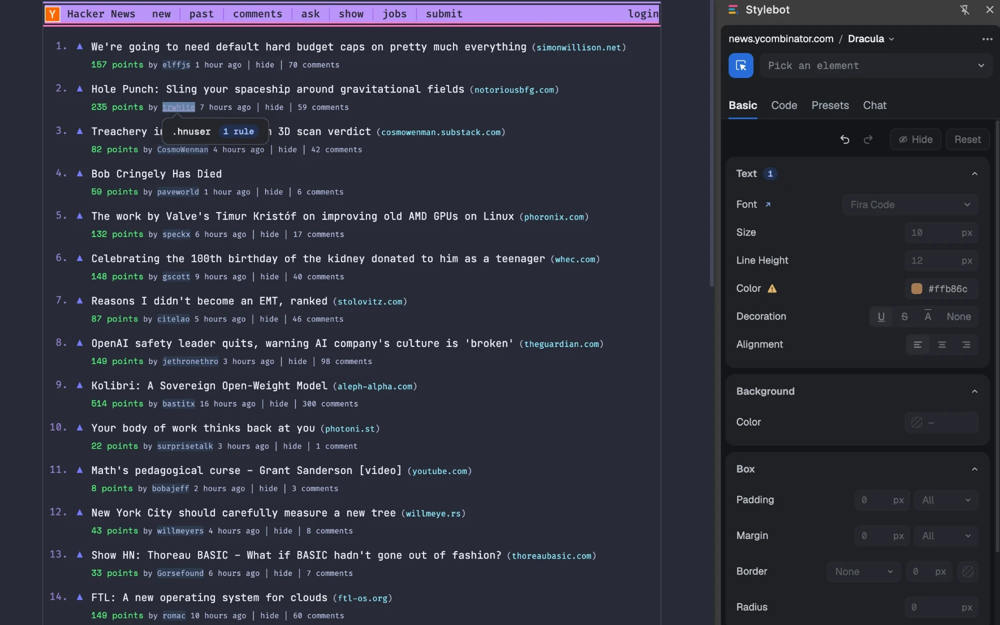

# NoBadFonts

Change the fonts and CSS of any website, in your browser.



- **Font library**: browse licensed typefaces and apply them to any element.
- **Visual editor**: pick any element and restyle it, no CSS needed. Dock it beside the page or pop it out.
- **Code editor**: write your own CSS with autocomplete and color swatches.
- **Instant**: every change applies as you make it and saves automatically.
- **Profiles**: keep several named looks for a site and switch between them.
- **Presets**: Readability for distraction-free articles, Grayscale to mute color.
- **History**: restore any site's earlier versions.
- **Backup**: export and import your styles as JSON.

Free and open source. No tracking, no ads.

## Extension

The extension lives in this repo and builds for Chrome, Edge and Firefox:

```bash
yarn install
yarn build          # Chrome/Edge into dist/
yarn build:firefox  # Firefox into firefox-dist/
```

See [docs/development.md](docs/development.md) for setup and [docs/releases.md](docs/releases.md) for packaging.

## The website

The NoBadFonts website is in a separate repo, [fontique](https://github.com/Bismay-exe/fontique). It hosts the font catalog, docs and legal pages the extension links to.

## Contributing

- **Contribute**: bug fixes, features and translations are welcome — see [CONTRIBUTING.md](CONTRIBUTING.md)
- **Developer docs**: setup, architecture and testing in [docs/](docs/README.md)
- **Support**: open an issue in the [extension repo](https://github.com/Bismay-exe/nobadfonts-extension/issues)

## License

NoBadFonts is released under the [MIT License](LICENSE), which preserves the original Stylebot copyright.
